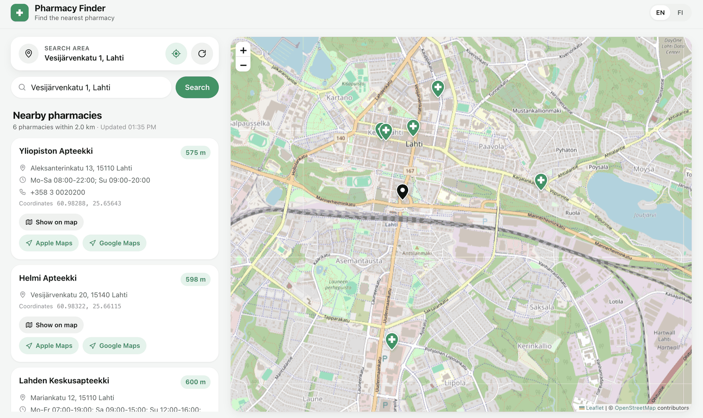
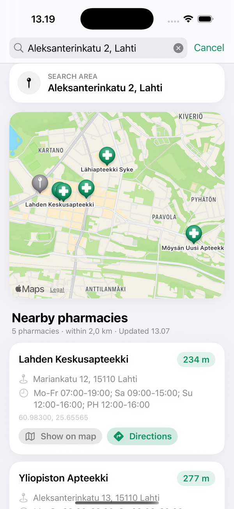
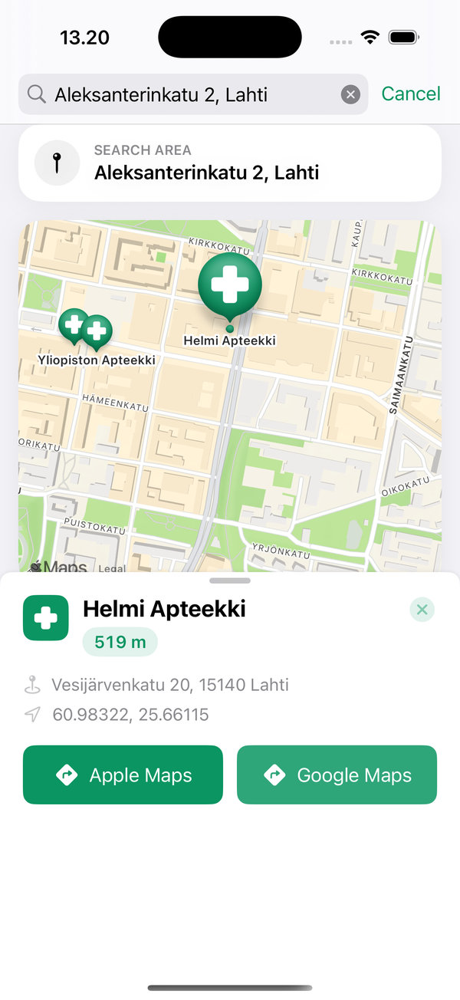
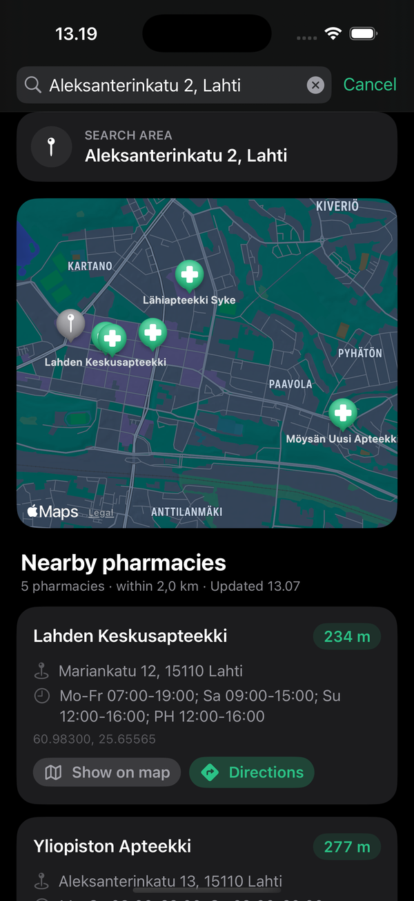
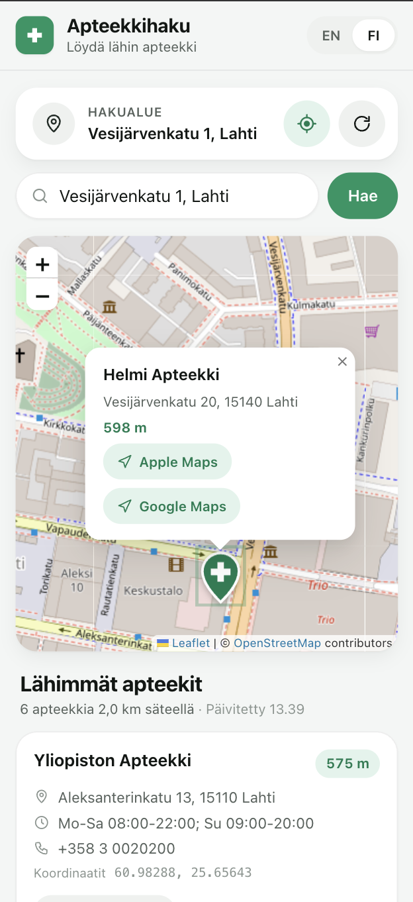

# Pharmacy Finder

Find the pharmacies nearest to you, from live OpenStreetMap data, in two apps with the
same core features:

| App     | Stack                                                       | Docs                             |
| ------- | ----------------------------------------------------------- | -------------------------------- |
| **Web** | React 19, TypeScript (strict), Vite, Leaflet                | [`web/README.md`](web/README.md) |
| **iOS** | Swift, SwiftUI, MapKit, CoreLocation, async/await (iOS 17+) | [`ios/README.md`](ios/README.md) |

<p align="center">
  
</p>

<p align="center">
  
  
  
  
</p>

Both apps:

- ask for location permission, show the user on the map, and handle denial with a
  retry option and an address / city search;
- find `amenity=pharmacy` and `healthcare=pharmacy` objects around that point
  (Overpass API, with Postpass as a fallback when Overpass is unavailable);
- show pharmacies on a map and in a list sorted by distance (m / km), with address,
  coordinates, opening hours and phone when OpenStreetMap has them;
- open a route in Apple Maps or Google Maps;
- handle loading, empty results, offline, timeouts, rate limits and missing data
  (no invented names or addresses);
- are available in English and Finnish.

## Repository layout

```
.
├── web/                       React + TypeScript app (Vite, Vitest)
├── ios/                       SwiftUI app (Xcode project, Swift Testing)
├── docs/
│   └── TECHNICAL_DECISIONS.md Architecture decisions and trade-offs
└── .github/workflows/         CI for the web app
```

## Quick start

```bash
# Web (Node.js 20.19+)
cd web && npm install && npm run dev      # http://localhost:5173
npm test                                  # unit and component tests

# iOS (Xcode 16+)
open ios/PharmacyFinder/PharmacyFinder.xcodeproj   # then ⌘R to run, ⌘U to test
```

## Data sources

| Service                                                          | Purpose                                           |
| ---------------------------------------------------------------- | ------------------------------------------------- |
| [Overpass API](https://wiki.openstreetmap.org/wiki/Overpass_API) | Pharmacy search (primary)                         |
| [Postpass](https://wiki.openstreetmap.org/wiki/Postpass)         | Pharmacy search (fallback, same OSM data via SQL) |
| [Nominatim](https://nominatim.org)                               | Address search on the web                         |
| Apple `CLGeocoder`                                               | Address search on iOS                             |
| OpenStreetMap tiles / Apple Maps                                 | Map background                                    |

Map and pharmacy data © [OpenStreetMap contributors](https://www.openstreetmap.org/copyright), ODbL.

## Technical decisions

[`docs/TECHNICAL_DECISIONS.md`](docs/TECHNICAL_DECISIONS.md) records the main decisions:
state modelling, race conditions, the Overpass → Postpass fallback, testing approach,
localisation, accessibility and privacy.

## How it was built

The apps were developed with Claude (Anthropic) as an AI coding agent: planning,
implementation and review were done in iterations, with every change checked by the
compilers, linters and tests and tried out in the browser and the iOS simulator.
Decisions about architecture, data sources and design were made and reviewed by me.
