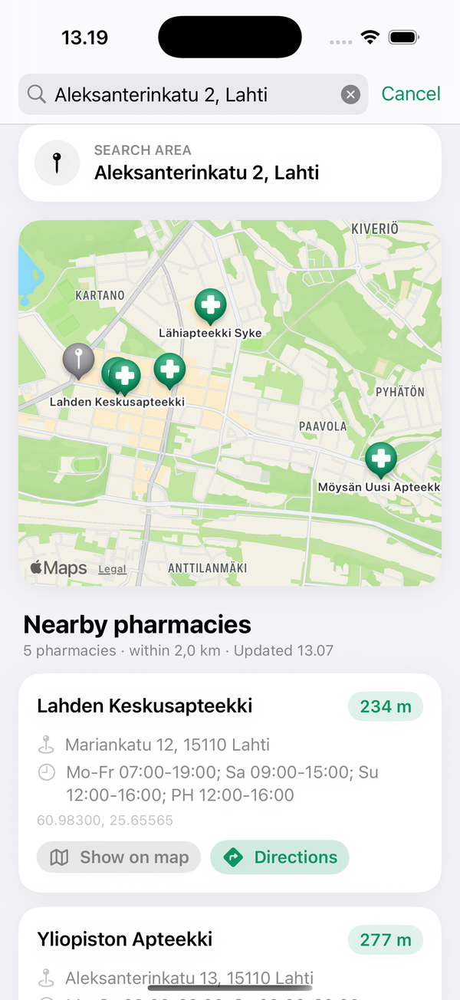
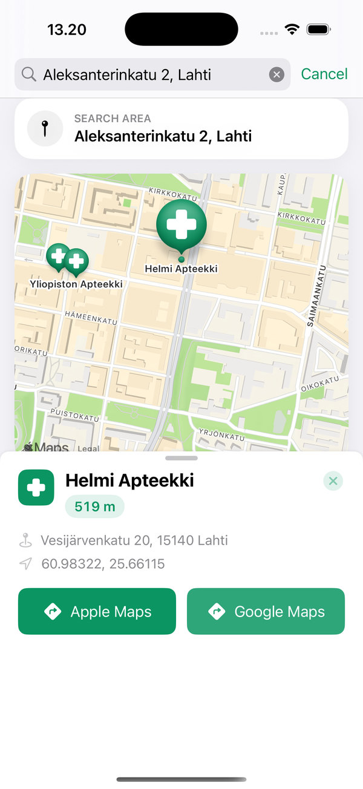
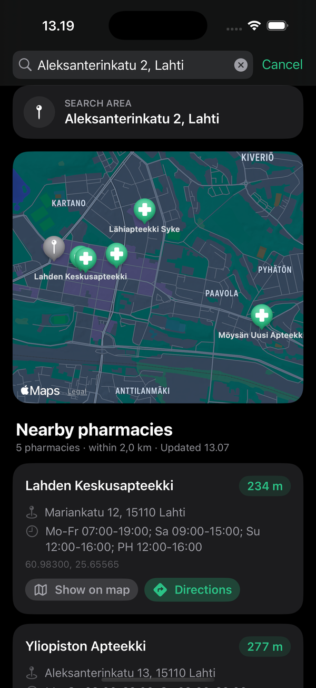

# Pharmacy Finder — iOS

Native SwiftUI app that finds the pharmacies nearest to the user, using live
OpenStreetMap data. It has the same core features as the [web app](../web).

The UI follows the device language: **English** or **Finnish** (Settings → Pharmacy
Finder → Language lets users pick per app, as is standard on iOS).

<p align="center">
  
  
  
</p>

## Features

- **Location** with CoreLocation: permission is requested from a user action; if it
  was granted earlier, the app locates automatically on launch. Denied access shows an
  _Open Settings_ button, and the app picks up a permission granted in Settings when
  it returns to the foreground.
- **Address search** in the native search bar (Apple `CLGeocoder`), so the app is
  fully usable without location access.
- **Pharmacy search** in OpenStreetMap: Overpass API first, Postpass as a fallback
  (see [Data sources](#data-sources)). The radius widens 2 → 5 → 10 km until results
  are found.
- **Map** (MapKit for SwiftUI): user location with accuracy circle or search point,
  pharmacy markers, and Apple's own points of interest hidden so only OSM pharmacies
  appear.
- **List** sorted by distance: name, address, distance (m / km), coordinates, opening
  hours, _Show on map_, and a directions menu.
- **Details sheet** on marker tap: address, hours, phone (tap to call), coordinates and
  directions in Apple Maps or Google Maps (app if installed, website otherwise).
- **Refresh**: toolbar buttons and pull to refresh.
- **States**: welcome, loading skeleton, empty result, full-screen and inline errors,
  offline banner (`NWPathMonitor`).
- **Missing data** is shown as "Unnamed pharmacy" / "Address not available", never
  invented.

## Requirements

- Xcode 16 or later (the project uses folder-synchronised groups and Swift Testing)
- iOS 17.0+ deployment target

## Running

1. Open `PharmacyFinder/PharmacyFinder.xcodeproj`.
2. Choose a simulator and press ⌘R.
3. In the simulator, set a location with **Features → Location → Custom Location…**
   (for example 60.9827, 25.6615 for Lahti).

To run on an iPhone: select your Apple ID team under _Signing & Capabilities_, choose
the device and press ⌘R. With a free Apple ID the build stays valid for 7 days.

Tests: ⌘U in Xcode, or from the command line:

```bash
xcodebuild test -project PharmacyFinder/PharmacyFinder.xcodeproj -scheme PharmacyFinder \
  -destination 'platform=iOS Simulator,name=iPhone 16' -only-testing:PharmacyFinderTests
```

## Architecture (MVVM)

```
PharmacyFinder/
├── Models/       Pharmacy, Coordinate, SearchOrigin, PharmacyError,
│                 OverpassResponse / PostpassResponse (Decodable DTOs)
├── Views/        ContentView, PharmacyMapView, PharmacyRow, PharmacyDetailSheet,
│                 LocationStatusCard, StateViews, DirectionsMenu, Theme
├── ViewModels/   PharmacyViewModel
├── Services/     PharmacyService, OSMDataSource (Overpass, Postpass),
│                 GeocodingService, HTTPClient
├── Managers/     LocationManager, NetworkMonitor
├── Utilities/    DistanceCalculator, DistanceFormatter, PharmacyMapper, sorting,
│                 query builders, DirectionsURLBuilder, MapRegionCalculator, L10n
└── Resources/    Localizable.xcstrings, InfoPlist.xcstrings
```

- **`PharmacyViewModel`** (`@MainActor @Observable`) owns all screen state. The
  results area is a derived `ResultsState` (welcome / loading / failed / empty /
  results), so the view can't show contradictory states. Views only render state and
  forward user intents.
- **Cancellation**: every user action starts a new `Task` and cancels the previous one;
  results of a cancelled task are discarded, so a slow response never overwrites a
  newer one.
- **`PharmacyService`** is an `actor`: the response cache and the per-source cool-down
  are safe under concurrent searches.
- **`LocationManager`** wraps `CLLocationManager` delegate callbacks in
  `CheckedContinuation`s, so the view model simply `await`s a location.
- **Dependency injection through protocols** (`PharmacyServicing`, `LocationProviding`,
  `Geocoding`, `HTTPClient`): the view model and the service are tested with mocks,
  without network or GPS.
- **Errors** are one `enum PharmacyError` mapped from `URLError`, `CLError` and HTTP
  status codes, each with a localised message and a retry / Settings action.
- **No force unwraps**; JSON is decoded with `Codable`, and a malformed element is
  skipped instead of failing the whole response.

## Data sources

| Service                                                          | Used for                   | Notes                                                                                      |
| ---------------------------------------------------------------- | -------------------------- | ------------------------------------------------------------------------------------------ |
| [Overpass API](https://wiki.openstreetmap.org/wiki/Overpass_API) | Pharmacy search (primary)  | `nwr` + `out center` covers points and building outlines; 8 s server / 10 s client timeout |
| [Postpass](https://wiki.openstreetmap.org/wiki/Postpass)         | Pharmacy search (fallback) | Same OSM data through SQL/PostGIS; used when Overpass fails                                |
| Apple `CLGeocoder`                                               | Address search, place name | No usage-policy limits, follows the device language                                        |
| Apple Maps                                                       | Map background             | MapKit for SwiftUI                                                                         |

Requests identify the app with a `User-Agent` and `Referer`, as the public OSM services
require. Responses are cached for 5 minutes on a ~110 m grid, _Refresh_ reuses data
younger than 30 seconds, and a source that failed is skipped for 5 minutes.

## Testing

Swift Testing suites in `PharmacyFinderTests/`, all offline with fictional fixtures:

| Suite                    | Covers                                                                                                             |
| ------------------------ | ------------------------------------------------------------------------------------------------------------------ |
| `PharmacyModelTests`     | Decoding, mapping, name / address fallbacks, de-duplication, `Codable` round trip, query building                  |
| `DistanceTests`          | Haversine against known distances, formatting in English and Finnish                                               |
| `PharmacySortingTests`   | Ordering and deterministic tie-breaking                                                                            |
| `PharmacyViewModelTests` | View model with mock services: locate, permission denied, errors, empty, address search, refresh, retry, selection |
| `PharmacyServiceTests`   | Service with a mock HTTP client: radius expansion, Postpass fallback, cool-down, offline, caching                  |
| `PostpassTests`          | SQL building and GeoJSON decoding                                                                                  |
| `DirectionsAndMapTests`  | Apple / Google Maps URLs and map framing                                                                           |

## Limitations

- Data is only as complete as OpenStreetMap; some pharmacies lack an address or hours.
- Opening hours are shown in raw OSM syntax, not parsed into "open now".
- Overpass and Postpass are shared public services without an SLA; a production app
  would use its own instance or a commercial provider.
- Distances are straight-line, not walking or driving distance.
- The app language follows iOS settings; there is no in-app language switch.
