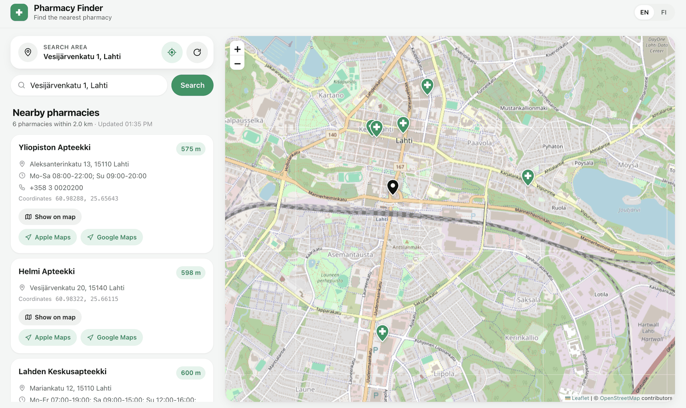
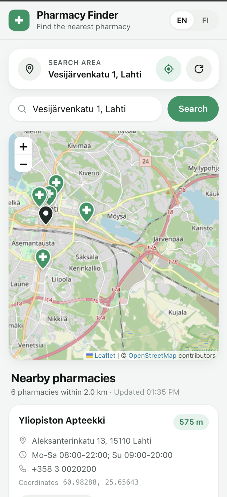
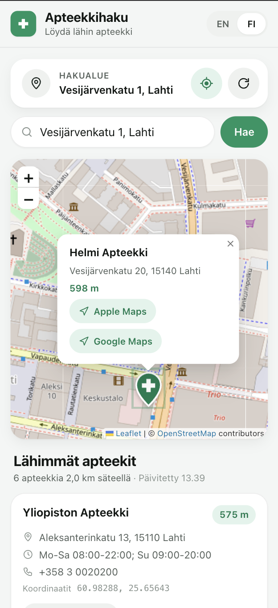

# Pharmacy Finder — Web

A responsive web app that finds the pharmacies nearest to the user, using live
OpenStreetMap data. It is one of two apps in this repository; the native iOS
version lives in [`../ios`](../ios).

The UI is available in **English** and **Finnish** (detected from the browser,
switchable in the header).

<p align="center">
  
</p>

<p align="center">
  
  
</p>

## Features

- **Location**: asks for geolocation permission when the user taps the button, not on
  page load. If permission was granted earlier, the app locates the user automatically.
  It shows accuracy and a readable place name (reverse geocoding).
- **Address search**: works without location access. A search by address or city runs
  on the OpenStreetMap geocoder (Nominatim).
- **Pharmacy search**: live Overpass API query for `amenity=pharmacy` and
  `healthcare=pharmacy`, covering nodes, building outlines and relations. If Overpass is
  unavailable, the same OpenStreetMap data is fetched from Postpass instead. The radius
  widens automatically (2 → 5 → 10 km) until results are found.
- **Map**: Leaflet + OpenStreetMap tiles. Shows the user's position with an accuracy
  circle (or a search-point pin), custom pharmacy markers, and a popup with details
  and directions on tap.
- **List**: sorted by distance. Each card shows the name, address, distance (m / km),
  coordinates, opening hours and phone when OSM has them, plus _Show on map_.
- **Directions**: opens a route in Apple Maps or Google Maps.
- **Refresh**: update location / refresh results buttons.
- **States**: welcome, loading skeleton, empty result, inline and full-screen errors,
  offline banner.
- **Missing data**: a pharmacy without a name or address is shown with a clear
  placeholder ("Unnamed pharmacy", "Address not available"). Nothing is invented.
- **Responsive**: single column on phones (controls → map → list), sidebar + full-height
  map on desktop.

## Tech stack

| Area    | Choice                                                       |
| ------- | ------------------------------------------------------------ |
| UI      | React 19, TypeScript (strict), React Hooks                   |
| Build   | Vite                                                         |
| Map     | Leaflet + react-leaflet, OpenStreetMap tiles                 |
| Data    | Overpass API + Postpass fallback (pharmacies), Nominatim     |
| Styling | Modern CSS: design tokens in custom properties + CSS Modules |
| Testing | Vitest, Testing Library, jsdom                               |
| Quality | ESLint (typescript-eslint, react-hooks)                      |

There is no UI or state library. The app is small enough that typed hooks and a
reducer keep it clearer than a framework would.

## Getting started

Requires **Node.js 20.19+**.

```bash
cd web
npm install
npm run dev        # http://localhost:5173
```

| Script              | What it does                          |
| ------------------- | ------------------------------------- |
| `npm run dev`       | Development server                    |
| `npm run build`     | Type-check and production build       |
| `npm run preview`   | Serve the production build locally    |
| `npm run typecheck` | TypeScript only                       |
| `npm run lint`      | ESLint                                |
| `npm test`          | Unit and component tests (no network) |

> **Geolocation needs a secure context.** `localhost` works out of the box. To test
> on a phone over the local network, serve the app over HTTPS (e.g. deploy the `dist`
> folder to any static host, or use a tunnel). Otherwise the browser denies location
> access, and address search remains available.

## Architecture

```
src/
├── pages/        HomePage — layout and composition only
├── components/   Presentational components (map/, list, cards, status views, buttons)
├── hooks/        usePharmacyFinder (orchestration), finderReducer (state machine),
│                 useGeolocationPermission, useOnlineStatus / useMediaQuery
├── services/     pharmacyService + dataSources (Overpass, Postpass),
│                 geocodingService (Nominatim),
│                 locationService (Geolocation API), http (fetch + timeout + errors)
├── i18n/         Typed EN/FI dictionaries, LanguageProvider, useI18n
├── types/        Domain models, Overpass DTOs, AppError
├── utils/        Pure functions: distance, formatting, sorting, Overpass/Postpass mapping,
│                 directions URLs, TTL cache, abort helpers
├── styles/       Design tokens, global and Leaflet styles
└── test/         Test setup and fictional fixtures
```

**Data flow**: a user action in `HomePage` calls `usePharmacyFinder`, which talks to
the services and dispatches to `finderReducer`. Components render from that state.
Business logic never lives in components, and services never touch React.

Key decisions:

- **State as a discriminated union.** `status` is one of `idle | locating | geocoding |
searching | success | error`, so impossible combinations cannot be represented.
  "Empty" is derived (success with zero results).
- **Race-condition safety.** Each user action starts a new operation and aborts the
  previous request (`AbortController`). Results of superseded operations are ignored.
- **Dependency injection.** Services are created by factories (`createPharmacyService`)
  that accept `fetch`, endpoints, cache and timings. Tests use fakes; the app uses the
  defaults.
- **Untrusted input is validated.** Overpass, Postpass and Nominatim JSON is checked at runtime
  before it becomes typed data. Malformed elements are dropped, not fatal.
- **Typed i18n.** The Finnish dictionary must have every English key, and every
  `AppErrorKind` must have a message. A missing translation is a compile error.

## APIs and fair use

| API                                                                  | Used for                   | Protection                                                                                                                                                                                                     |
| -------------------------------------------------------------------- | -------------------------- | -------------------------------------------------------------------------------------------------------------------------------------------------------------------------------------------------------------- |
| [Overpass API](https://wiki.openstreetmap.org/wiki/Overpass_API)     | Pharmacy search (primary)  | 8 s server timeout (busy servers schedule short queries sooner) + 10 s client timeout; 5-minute cache on a ~110 m grid; _Refresh_ reuses data younger than 30 s; the map never triggers requests while panning |
| [Postpass](https://wiki.openstreetmap.org/wiki/Postpass)             | Pharmacy search (fallback) | Used when Overpass fails (429, 5xx, timeout, invalid data). Same OSM data through PostGIS; the failed source is skipped for 5 minutes so users don't wait for the same timeout twice                           |
| [Nominatim](https://nominatim.org/release-docs/latest/api/Overview/) | Address search, place name | Searches only on submit (no autocomplete); at most 1 request per second, as the [usage policy](https://operations.osmfoundation.org/policies/nominatim/) requires                                              |
| [OSM tiles](https://operations.osmfoundation.org/policies/tiles/)    | Map background             | Standard tile server with attribution                                                                                                                                                                          |

Data © [OpenStreetMap contributors](https://www.openstreetmap.org/copyright), ODbL.

### Overpass query

```
[out:json][timeout:8];
(
  nwr["amenity"="pharmacy"](around:2000,60.982700,25.661500);
  nwr["healthcare"="pharmacy"](around:2000,60.982700,25.661500);
);
out center;
```

`nwr` matters because many pharmacies are mapped as building outlines, not points.
`out center` gives those a single coordinate.

### Why a fallback source

In 2026 the public Overpass servers are often overloaded and enforce stricter limits
(user-agent checks, per-IP quotas). During development the app regularly got HTTP 502
or no response at all. [Postpass](https://github.com/woodpeck/postpass) by Geofabrik
serves the same OpenStreetMap data through SQL, so the fallback query is equivalent:

```sql
SELECT osm_type, osm_id, tags, ST_PointOnSurface(geom) AS geom
FROM postpass_pointpolygon
WHERE (tags->>'amenity' = 'pharmacy' OR tags->>'healthcare' = 'pharmacy')
  AND geom && ST_MakeEnvelope(…, 4326)            -- bounding box, uses the spatial index
  AND ST_DWithin(geom::geography, <origin>::geography, 2000)
LIMIT 200
```

Both responses are converted to the same internal element type, so mapping, sorting and
the UI don't know which source answered.

## Error handling

Every failure is mapped to an `AppError` with a `kind`, and each kind has its own
message in both languages:

| Kind                                                                                       | Cause                                                          |
| ------------------------------------------------------------------------------------------ | -------------------------------------------------------------- |
| `permission-denied`, `position-unavailable`, `location-timeout`, `geolocation-unsupported` | Geolocation API                                                |
| `offline`, `network`                                                                       | `fetch` failed (offline if `navigator.onLine` is false)        |
| `timeout`                                                                                  | Client timeout, HTTP 504 or an Overpass "runtime error" remark |
| `rate-limited`                                                                             | HTTP 429                                                       |
| `server`, `invalid-response`                                                               | Other HTTP errors, unexpected JSON                             |
| `address-not-found`                                                                        | Geocoder found nothing                                         |

A failed refresh keeps the previous results on screen with an inline banner, and
_Try again_ repeats whichever step failed.

## Testing

```bash
npm test
```

The tests run fully offline with fictional fixtures:

- `utils/distance.test.ts`: haversine against known distances, symmetry, antimeridian.
- `utils/sortPharmacies.test.ts`: ordering, tie-breaking, immutability.
- `utils/overpass.test.ts`: query building, response validation, name and address
  fallbacks, de-duplication, `center` handling.
- `utils/postpass.test.ts`: SQL building (filters, radius, bounding box) and GeoJSON
  validation.
- `services/pharmacyService.test.ts`: API processing with a fake `fetch`: radius
  expansion, fallback to Postpass (429, 502, error page, runtime error), source
  cool-down, offline, timeouts, cancellation, caching.
- `utils/format.test.ts`: m / km formatting in English and Finnish.
- `hooks/finderReducer.test.ts`: state transitions.
- `components/PharmacyCard.test.tsx`: rendering, placeholders, directions links.

## Limitations

- Results are only as complete as OpenStreetMap. Some pharmacies may be missing or
  lack an address or opening hours.
- Opening hours are shown in raw OSM syntax (e.g. `Mo-Fr 09:00-18:00`). They are not
  parsed into "open now".
- Overpass, Postpass and Nominatim are shared, best-effort public services. A
  production app should use its own instance or a commercial provider.
- Distances are straight-line (great-circle), not walking or driving distance.
- Directions from the user's position rely on the maps app's own location. For
  address searches, the searched point is passed as the route origin.
